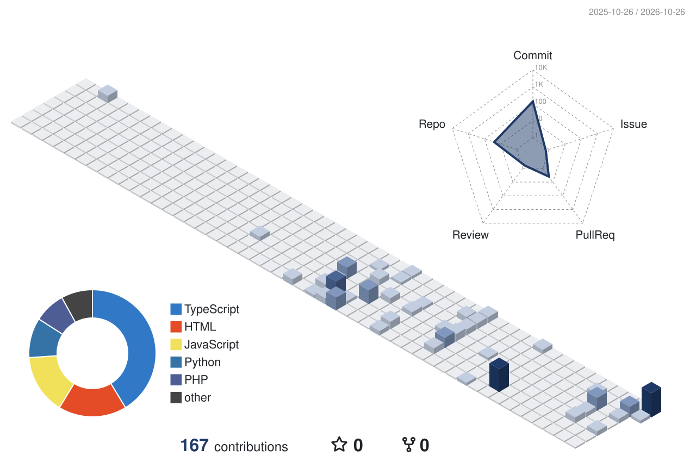

<p align="center">
  <picture>
    <source media="(prefers-color-scheme: dark)" srcset="./logo-dark.svg">
    
  </picture>
</p>

<h1 align="center">Hi, I'm Juan Whitty 👋</h1>

<p align="center">
  <b>Computer Science (Data Science) student at FEU Institute of Technology, Manila</b><br>
  <sub>President, ACM FEU Tech Student Chapter</sub>
</p>

<p align="center">
  <a href="https://www.linkedin.com/in/juanbwhitty"></a>
  <a href="mailto:juanangeloroy.whitty@gmail.com"></a>
</p>

<br>

### 📓 `u1yuan.ipynb`


---

`In [1]:`

```python
from u1yuan import Juan

juan = Juan()
juan.about()
```

`Out[1]:`

I turn messy data into clear, evidence-based insights with Python, SQL, and statistics, and I build practical tools that people actually use, not side projects built just for the sake of building.

> [!NOTE]
> 🔎 **Currently seeking data analytics internships.** Reach me on [LinkedIn](https://www.linkedin.com/in/juanbwhitty) or at [juanangeloroy.whitty@gmail.com](mailto:juanangeloroy.whitty@gmail.com).

---

`In [2]:`

```python
juan.working_on()
```

`Out[2]:`

- **Machine learning coursework (CS 0075):** model tuning with scikit-learn and Optuna
- **Workflow automation:** a daily Canvas-to-Notion task sync built on MCP and GitHub Actions
- **AI engineering:** harness and context engineering through custom agent skills, MCP tool integrations, and scheduled agent routines
- **Leading ACM FEU Tech:** 21 officers, 5 chapter projects, 402 members enrolled in the first term

---

`In [3]:`

```python
juan.projects(kind="data")  # -> pandas.DataFrame
```

`Out[3]:`

| | &nbsp;&nbsp;&nbsp;&nbsp;&nbsp;&nbsp;&nbsp; | project | what_it_does | stack |
| --: | :-: | :-- | :-- | :-- |
| **0** |  | **Philippine Earthquakes Analytics** | Cleaned 35,541 seismic records (1996–2026) and built a Poisson-based 30-day probability model; walk-forward backtest (2019–2024) beat the 0.25 Brier random baseline | Python · Pandas · GeoPandas · Folium · Plotly |
| **1** |  | [**Instagram Usage & Well-Being**](https://github.com/u1yuan/instagram-usage-and-well-being-case-study) | Analyzed a 1.5M+ record synthetic dataset with 8 engineered features; found a strong usage–stress link (ρ = 0.84), written up as an APA research report | Python · pandas · SciPy · seaborn |
| **2** |  | [**ML team lab (CS 0075)**](https://github.com/u1yuan/ml-ta3) | Tuned Random Forests with grid and Bayesian search: heart-disease F1 from 0.571 to 0.628, housing regression R² 0.89 | Python · scikit-learn · Optuna |
| **3** |  | **Canvas-to-Notion Task Automation** | Daily automated sync across 7 courses and 193 assignments; idempotent re-runs, 33 tests, and a dry-run mode | Python · GitHub Actions · MCP · Notion API |

<sub>4 rows × 3 columns</sub>

---

`In [4]:`

```python
juan.projects(kind="builds")  # -> pandas.DataFrame
```

`Out[4]:`

| | &nbsp;&nbsp;&nbsp;&nbsp;&nbsp;&nbsp;&nbsp; | project | description |
| --: | :-: | :-- | :-- |
| **0** |  | [**Protektahanan**](https://github.com/u1yuan/protektahanan)<br><sub>[live ↗](https://protektahanan.vercel.app)</sub> | Bilingual, senior-friendly scam-pattern checker that works without an API key |
| **1** |  | [**DevNet Reviewer**](https://github.com/u1yuan/revwi)<br><sub>[live ↗](https://revwi.vercel.app)</sub> | Local exam reviewer with 122 verified questions curated from 149 exported source items |
| **2** |  | [**Remento**](https://github.com/u1yuan/remento)<br><sub>[live ↗](https://remento.vercel.app)</sub> | Keeps event moments and new connections together, then returns them as a private recap |
| **3** |  | [**Pastely**](https://github.com/u1yuan/pastely)<br><sub>[live ↗](https://pastely-six.vercel.app)</sub> | Photograph a sticker, remove its background on-device, and arrange it in a shareable library |
| **4** |  | [**CCSMA Scrollytelling**](https://github.com/u1yuan/site-ccsma)<br><sub>[live ↗](https://site-ccsma.vercel.app)</sub> | Unofficial, statically exported Next.js concept site for FEU Tech's College of Computer Studies and Multimedia Arts |

<sub>5 rows × 2 columns</sub>

---

`In [5]:`

```python
juan.stack()
```

`Out[5]:`

| Languages | Data & ML | Notebooks, Web & Tools |
| :-- | :-- | :-- |
|         |         |        |

---

`In [6]:`

```python
juan.contributions(view="3d")
```

`Out[6]:`

<p align="center">
  <picture>
    <source media="(prefers-color-scheme: dark)" srcset="./profile-3d-contrib/profile-u1-dark.svg">
    
  </picture>
</p>

<p align="center">
  <picture>
    <source media="(prefers-color-scheme: dark)" srcset="https://streak-stats.demolab.com/?user=u1yuan&hide_border=true&background=0D1117&ring=6A8CC7&fire=6A8CC7&currStreakNum=E6EDF3&currStreakLabel=6A8CC7&sideNums=E6EDF3&sideLabels=8B949E&dates=8B949E&stroke=30363D">
    
  </picture>
</p>

<details>
<summary><b>📈 <code>juan.stats()</code></b></summary>
<br>

<picture>
  <source media="(prefers-color-scheme: dark)" srcset="https://github-readme-stats.vercel.app/api?username=u1yuan&show_icons=true&hide_border=true&count_private=true&theme=github_dark&icon_color=6A8CC7">
  
</picture>
<picture>
  <source media="(prefers-color-scheme: dark)" srcset="https://github-readme-stats.vercel.app/api/top-langs/?username=u1yuan&layout=compact&hide_border=true&theme=github_dark">
  
</picture>

</details>

---

`In [7]:`

```python
juan.connect()
```

`Out[7]:`

[](https://www.linkedin.com/in/juanbwhitty)
[](mailto:juanangeloroy.whitty@gmail.com)

`In [ ]:`

```python

```
