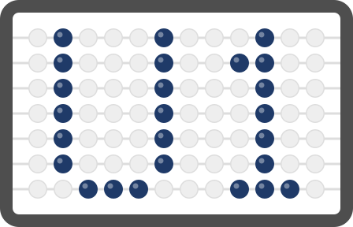

  

# Hi, I'm Juan Whitty 👋

  
  

**Computer Science (Data Science) student at FEU Institute of Technology, Manila** · President, ACM FEU Tech Student Chapter

I turn messy data into clear, evidence-based insights with Python, SQL, and statistics, and I build practical tools that people actually use, not side projects built just for the sake of building.

> [!NOTE]
> 🔎 **Currently seeking data analytics internships.** Reach me on [LinkedIn](https://www.linkedin.com/in/juanbwhitty) or at [juanangeloroy.whitty@gmail.com](mailto:juanangeloroy.whitty@gmail.com).

## 🔭 What I'm working on

- **Machine learning coursework (CS 0075):** model tuning with scikit-learn and Optuna
- **Workflow automation:** a daily Canvas-to-Notion task sync built on MCP and GitHub Actions
- **AI engineering:** harness and context engineering through custom agent skills, MCP tool integrations, and scheduled agent routines
- **Leading ACM FEU Tech:** 21 officers, 5 chapter projects, 402 members enrolled in the first term

## 📊 Data projects

| Project | What it does | Stack |
| :-- | :-- | :-- |
| **Philippine Earthquakes Analytics** | Cleaned 35,541 seismic records (1996–2026) and built a Poisson-based 30-day probability model; walk-forward backtest (2019–2024) beat the 0.25 Brier random baseline | Python · Pandas · GeoPandas · Folium · Plotly |
| [**Instagram Usage & Well-Being**](https://github.com/u1yuan/instagram-usage-and-well-being-case-study) | Analyzed a 1.5M+ record synthetic dataset with 8 engineered features; found a strong usage–stress link (ρ = 0.84), written up as an APA research report | Python · pandas · SciPy · seaborn |
| [**ML team lab (CS 0075)**](https://github.com/u1yuan/ml-ta3) | Tuned Random Forests with grid and Bayesian search: heart-disease F1 from 0.571 to 0.628, housing regression R² 0.89 | Python · scikit-learn · Optuna |
| **Canvas-to-Notion Task Automation** | Daily automated sync across 7 courses and 193 assignments; idempotent re-runs, 33 tests, and a dry-run mode | Python · GitHub Actions · MCP · Notion API |

## 🛠️ Things I've built

| Project | Description |
| :-- | :-- |
| [**Protektahanan**](https://github.com/u1yuan/protektahanan) · [live](https://protektahanan.vercel.app) | Bilingual, senior-friendly scam-pattern checker that works without an API key |
| [**DevNet Reviewer**](https://github.com/u1yuan/revwi) · [live](https://revwi.vercel.app) | Local exam reviewer with 122 verified questions curated from 149 exported source items |
| [**Remento**](https://github.com/u1yuan/remento) · [live](https://remento.vercel.app) | Keeps event moments and new connections together, then returns them as a private recap |
| [**Pastely**](https://github.com/u1yuan/pastely) · [live](https://pastely-six.vercel.app) | Photograph a sticker, remove its background on-device, and arrange it in a shareable library |
| [**CCSMA Scrollytelling**](https://github.com/u1yuan/site-ccsma) · [live](https://site-ccsma.vercel.app) | Unofficial, statically exported Next.js concept site for FEU Tech's College of Computer Studies and Multimedia Arts |

## 🧰 Tech stack

**Languages** 

**Data & ML** 

**Web & Tools** 

## 🏛️ Leadership

- **President, ACM FEU Tech Student Chapter** (Jul 2026–present): expanded the annual plan from 14 to 16 programs; 402 members enrolled in the first term, 84% of last year's full-year total
- **Head of Sponsorships, ACM FEU Tech** (Sep 2024–Jul 2025): doubled the sponsor network, securing ~₱75,000 in long-term agreements
- **Makati Local Youth Development Council** (Apr 2024–present): helped finalize the 2025–2030 Local Youth Development Plan for 200,000+ young residents

## 🔥 Contribution streak

  

<b>📈 GitHub stats</b>

 

## 📫 Connect

